# Greenroom

*Rehearse your English before the real conversation.*

Every performer gets a green room to prepare before going on stage. Greenroom is
that space for English learners: an **offline, open-source English speaking
coach** with a real desktop app, laid out like a chat app. Two ways to practise:

- **Chat with Sam, your English tutor.** Ask anything ("what's wrong with *I am
  having two years experience*?"), or just talk. Sam explains, corrects in the
  style you choose, and remembers what you told it last time.
- **Roleplay a real situation** with a character: a friendly buddy, an HR
  interviewer, a visa officer, a university admissions tutor, an impatient
  customer. They stay in character and never correct you.

You talk out loud or type. A local LLM answers in a natural voice while NLP
analyzers quietly study your English in the background. You choose whether
their feedback appears as small markers under your messages during the chat or
only in the report afterwards. Every session ends with a report: your own
sentences highlighted, three practice tasks, flashcards for the words you
overuse, and progress charts across sessions.

Everything runs on your machine: no accounts, no cloud APIs, no CDN. Models are
downloaded once by a setup script; after that the app works with the network
cable unplugged.

| | |
|---|---|
| 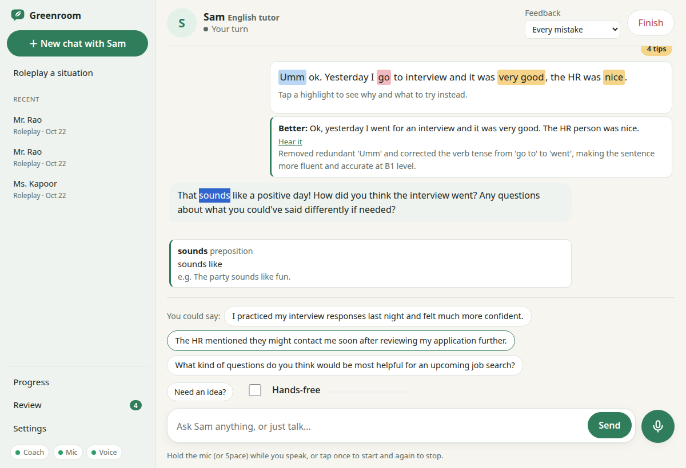 | 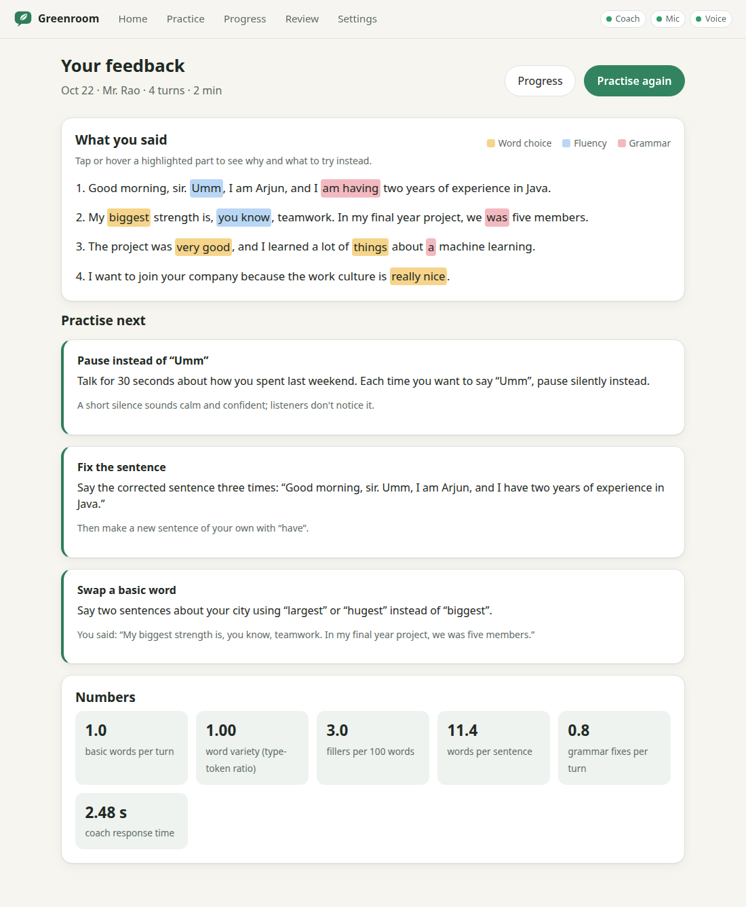 |
| **Chat with Sam**: feedback markers under your message, "Say it better", word meanings, ideas when you're stuck | **Report**: findings highlighted in your own words, hover for the why and the fix |

## Contents

- [Quick start](#quick-start)
- [The screens](#the-screens)
- [Tutor mode and in-chat feedback](#tutor-mode-and-in-chat-feedback)
- [How it works](#how-it-works)
- [Every module explained](#every-module-explained)
- [Evaluation](#evaluation)
- [Measured latency](#measured-latency)
- [Configuration](#configuration)
- [Design decisions](#design-decisions)
- [Tests](#tests)
- [Limitations](#limitations)
- [Future work](#future-work)
- [Troubleshooting](#troubleshooting)

## Quick start

Requirements: Python 3.10+, [Ollama](https://ollama.com), about 4 GB of disk for
models. An NVIDIA GPU is optional (used for the LLM and speech recognition).

```bash
python3 -m venv .venv && source .venv/bin/activate
pip install torch --index-url https://download.pytorch.org/whl/cpu   # CPU build is enough
pip install -r requirements.txt
python setup_models.py        # one time: spaCy, Kokoro, Whisper, BERT, T5, and `ollama pull qwen2.5:3b`
python greenroom.py           # opens the app in its own window
```

`setup_models.py` skips anything already downloaded and ends with a summary of
what is ready. `--no-nlp` skips the two optional NLP models (about 1.1 GB).

`python greenroom.py --browser` opens the app in your default browser instead
of a desktop window (the window falls back to the browser by itself if
pywebview can't start). Closing the window stops the app.

Developer commands:

```bash
python -m pytest -q                      # 88 tests; no GPU, mic, Ollama or downloads needed
python -m eval.eval_vocab --table        # vocabulary: baseline vs DistilBERT
python -m eval.eval_grammar --table      # grammar correction P/R/F1
python -m coach.config                   # detected hardware + effective config
python -m coach.tts "Hello there."       # speak a sentence to out.wav
python -m coach.stt recording.webm       # transcribe a file
```

## The screens

| | |
|---|---|
| 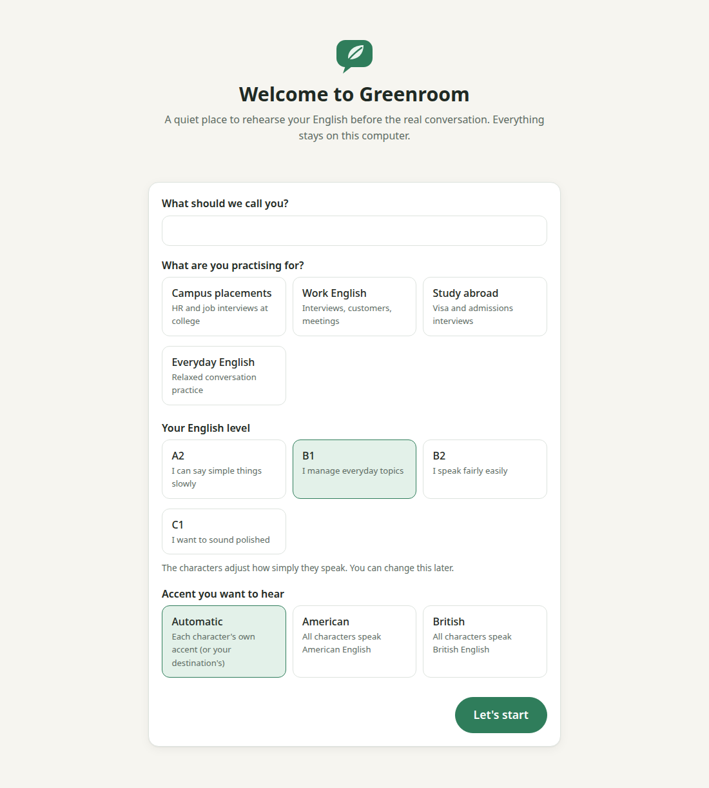 | 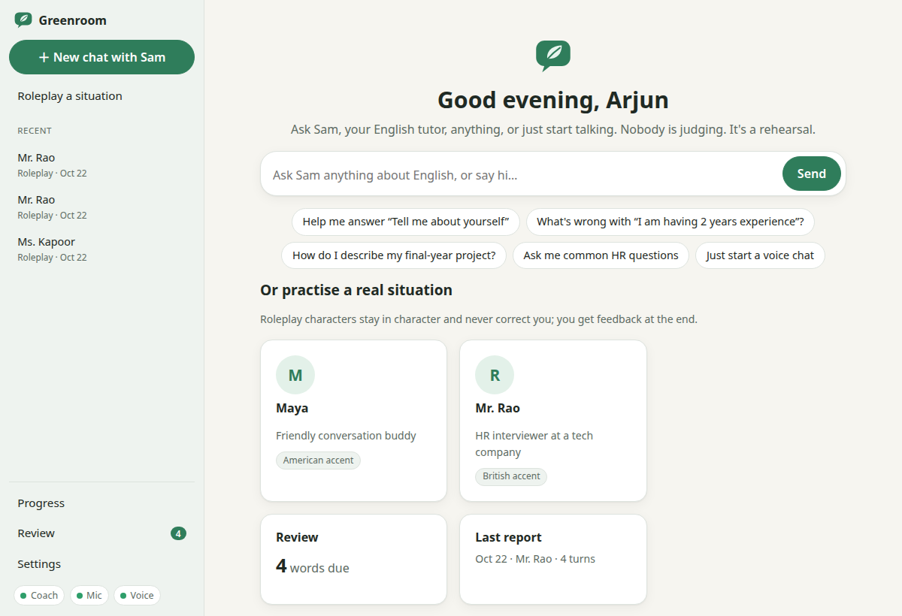 |
| **1. Onboarding** (first run): name, goal, level A2–C1, accent, study destination | **2. Start page**: ask Sam anything, conversation starters for your goal, roleplays; the sidebar keeps your recent conversations |
|  | 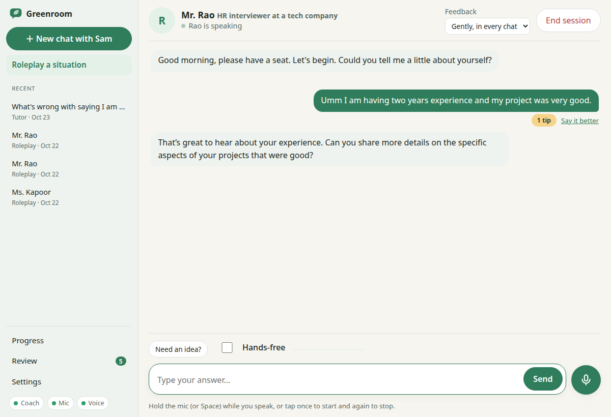 |
| **3. Chat with Sam**: markdown answers, markers under your messages, "Say it better", hints, word meanings | **4. Roleplay**: the character stays in character; with "Gently" chosen, one tip appears under your message |
| 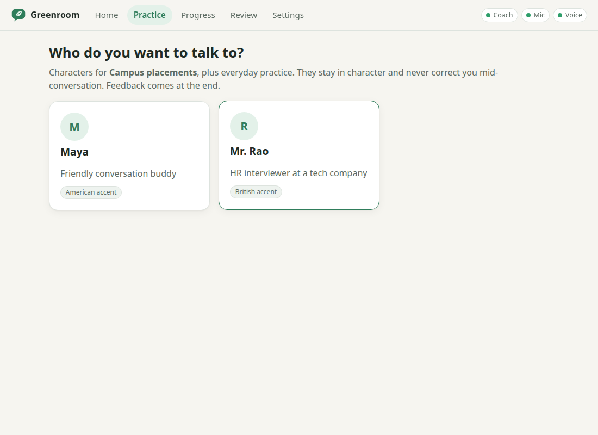 | 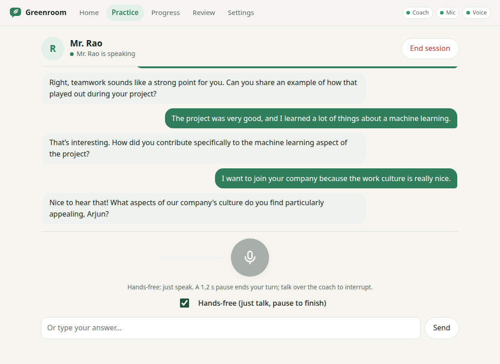 |
| **Choose a roleplay**: filtered by your goal + everyday practice; accent shown | **Voice**: push-to-talk or hands-free (barge-in), live transcript |
|  | 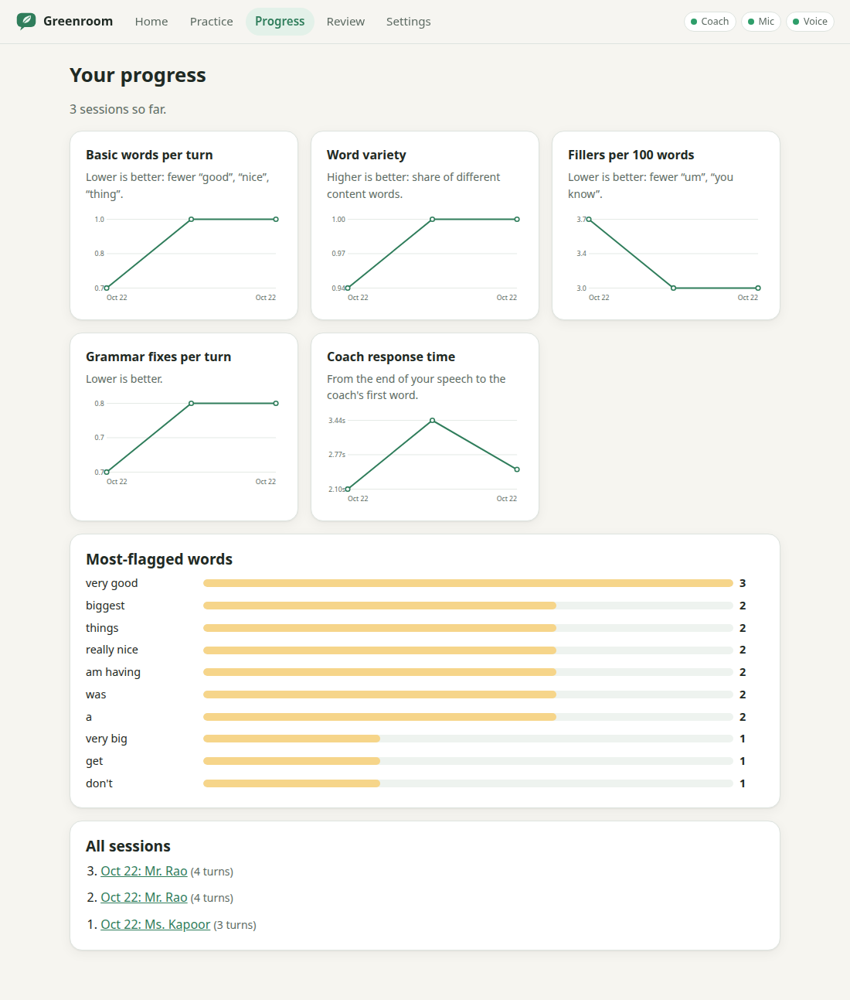 |
| **5. Report**: highlights, 3 exercises, numbers | **6. Progress**: trends (inline SVG), most-flagged words, all sessions |
| 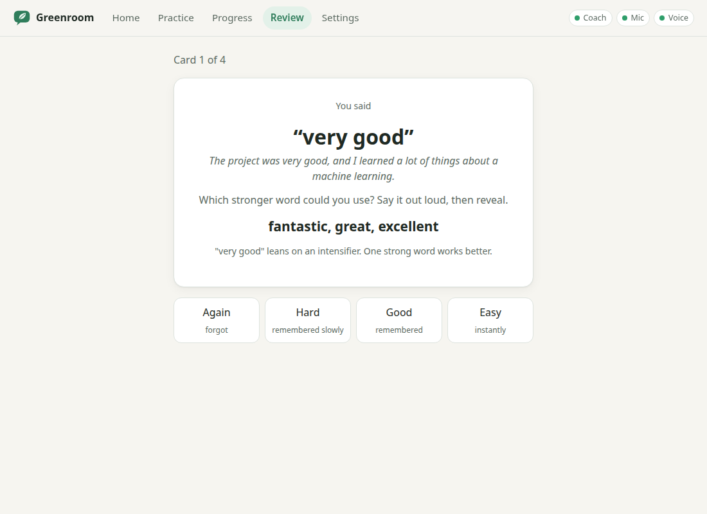 | 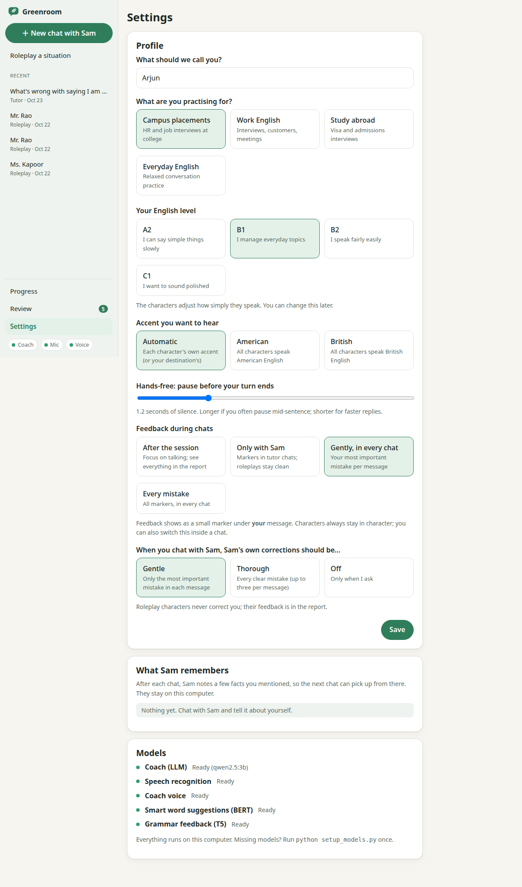 |
| **7. Review**: flashcards with Again / Hard / Good / Easy (SM-2) | **8. Settings**: profile, in-chat feedback, Sam's corrections, what Sam remembers, model status |

The layout also works at phone width:

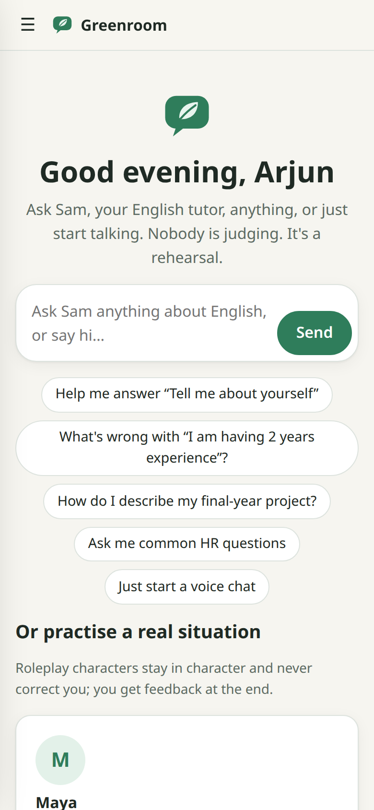 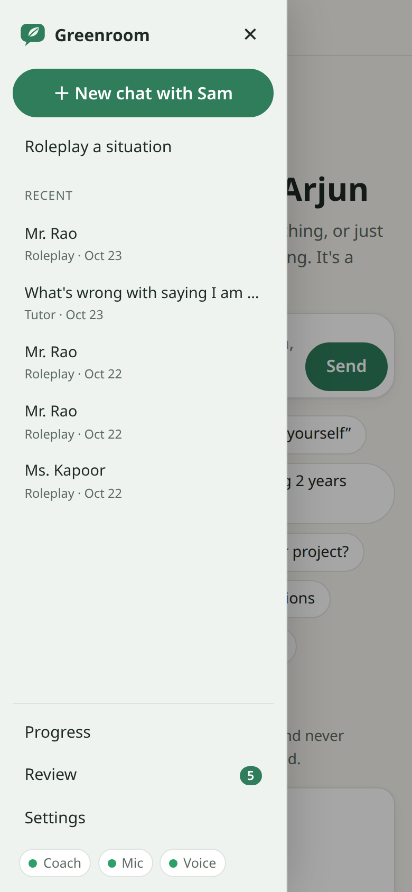 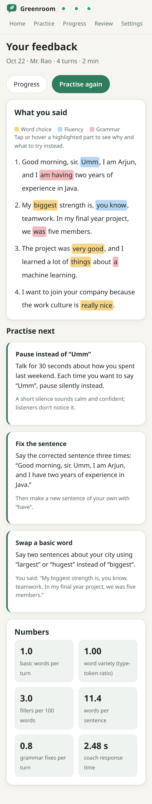

**Characters** (one JSON file each in `personas/`, so adding one = adding a file):

| Character | Role | Goals | Voice |
|---|---|---|---|
| **Sam** | **English tutor** (Tutor mode, `"mode": "tutor"`) | everyone | American female |
| Maya | friendly conversation buddy | general | American female |
| Mr. Rao | HR interviewer at a tech company | placements, job | British male |
| Ms. Kapoor | slightly impatient customer on a helpline (you're the agent) | job | American female |
| Officer Clarke | student visa officer | study abroad | American male |
| Dr. Whitfield | university admissions interviewer | study abroad | British female |

**Accent rule**: an explicit choice (American / British) wins; "automatic" +
study abroad uses the destination (UK, Ireland, Australia, New Zealand → British;
USA, Canada → American); otherwise each character keeps its own accent. The
character's gender never changes.

## Tutor mode and in-chat feedback

### What the top apps do, and what Greenroom took from them

Before this part was built, the features of the leading English-speaking apps
were compared from their public descriptions and reviews (not by decompiling
them: that breaks their terms, and their real value runs on their servers
anyway):

| Idea | Seen in | In Greenroom |
|---|---|---|
| Ask a tutor anything mid-practice | Speak's in-app tutor, Praktika, ChatGPT | **Sam** (Tutor mode) |
| Feedback inside the conversation | Speak's in-chat feedback; LocalTeacher's correction styles | **Feedback markers** you switch on or off |
| Remembers you between sessions | Praktika | **Memory** (facts + recurring mistakes) |
| Roleplays of real situations, feedback afterwards | Speak, Duolingo Max (Roleplay) | Roleplay characters + report (Phases 1–6) |
| Phoneme-level pronunciation scores | ELSA Speak | planned (Future work) |
| Exam mock with a band estimate | Stimuler, ELSA Speech Analyzer | planned (Future work) |

### In-chat feedback: the learner chooses

Research on correcting spoken mistakes points both ways: explicit corrections
are taken up more often than corrections hidden inside the teacher's reply
(about 50% vs 31% in Lyster & Ranta's classroom study), but how corrections
affect anxiety depends on the learner's level. So Greenroom lets the learner
choose, in Settings or with the **Feedback** switch at the top of every chat:

| Choice | During the chat | When to use it |
|---|---|---|
| **After the session** (default) | nothing; everything is in the report | focus on fluency, interview rehearsal |
| **Only with Sam** | markers in tutor chats; roleplays stay clean | learning with Sam, performing in roleplays |
| **Gently, in every chat** | the single most important mistake per message (grammar > weak words > fillers) | a light touch everywhere |
| **Every mistake** | all markers, in every chat | focused accuracy practice |

Whatever the choice, **feedback is only ever a marker under the learner's own
message**; roleplay characters never break character to correct. The markers
come from the same background analyzers as the report, so they appear a moment
after the reply and never slow it down. Sam's own spoken corrections are a
separate setting: gentle (the most important mistake), thorough (up to three) or off.

Both styles were built so they can be compared in use: "Only with Sam" keeps
correction inside the tutor, "Gently" / "Every mistake" bring it into roleplays.

### Help that never interrupts

- **Need an idea?** Three things you could say next, at your level (any chat).
- **Say it better**: a fluent version of one of your messages and the main reason
  (with Sam always; in roleplays only when you chose in-chat feedback).
- **Word meanings**: select a word in the coach's reply to get a simple
  meaning, the part of speech and an example.
- **Play again** on any reply; resumed chats are re-voiced on request.

Each helper is one extra LLM call made only when you press the button, and its
answer is forced into a JSON schema (Ollama structured outputs), so a small
model can't break the format the app reads.

### Memory: what Sam remembers

When a tutor chat closes, the LLM reads **only the learner's own messages** and
lists up to five new facts ("final-year CSE student from Coimbatore", "TCS
interview next Monday"). Small models make things up, so every fact is checked
against the learner's words (`memory.grounded()`): if most of its content words
weren't said, it is dropped. This caught a real case where the 3B model copied
an example out of the prompt. Recurring mistakes (overused words, grammar slips
with their fixes) come straight from the reports, with no LLM involved. Both go
into Sam's prompt; roleplay characters never get them (a real interviewer doesn't
know your hobbies). Settings shows every fact, with forget-one and forget-all.

## How it works

### One turn, through both paths

```
                                  ┌──────────────── REPLY PATH (what the learner waits for) ───────────────┐
 browser                          │  server                                                                  │
 ───────                          │  ──────                                                                  │
 mic ─► MediaRecorder (webm/opus) ─┼─► Whisper STT ─► session.user_turn ─► LLM tokens ─► SentenceChunker ──┐ │
        (push-to-talk or VAD)     │   (GPU, 0.36 s)  (qwen2.5:3b, Ollama,  (streamed)     "Hello there."  │ │
                                  │                    first token 0.16 s)               "How are you?"   │ │
 speakers ◄─ CoachPlayer queue ◄──┼────────── NDJSON stream: transcript, text deltas, WAV per sentence ◄──┘ │
             (plays in order)     │                                   ▲ Kokoro TTS per sentence (CPU)       │
                                  └───────────────────────────────────┼─────────────────────────────────────┘
                                                                      │ the first sentence is spoken while
                                                                      │ the LLM is still writing the second
                                  ┌──────────────── ANALYSIS PATH (background thread) ──────────────────────┐
                                  │  turn text ─► waits until the reply is produced ─► spaCy (once)        │
                                  │     ─► VocabularyAnalyzer (+ DistilBERT ranking)                        │
                                  │     ─► FluencyAnalyzer                                                  │
                                  │     ─► GrammarAnalyzer (T5 + difflib)        ─► findings + metrics      │
                                  └──────────────────────────────────────────────────────────────────────────┘
                                   end of session: report.summarize + exercises + flashcards ─► SQLite + JSON
```

Key ideas:

- **Analyzers never sit in the reply path.** The learner's turn is queued for
  analysis, and the reply never waits for it. Feedback appears only in the
  report after the session.
- **…and they don't compete with it either.** BERT and T5 run on the CPU, and
  so does Kokoro. When they overlapped, the first sentence's speech took 2.4 s
  instead of ~1 s. So the analysis of a turn waits until the coach's reply has
  been produced, then runs while the coach is talking, when the CPU is idle
  (`Session.replying()`).
- **The coach starts talking before its reply is finished.** LLM tokens are cut
  into sentences (`SentenceChunker`, which knows "Mr." and "3.5" don't end a
  sentence); each sentence is synthesized and sent as soon as it is complete.
- **Characters stay in character and never correct you.** The system prompt
  forbids it; correction is the analyzers' job, after the session.
- **Every analyzer follows one contract** (`coach/analyzers/base.py`): a spaCy
  `Doc` in, `Finding`s (exact character spans, message, suggestions) and
  metrics out. The report, progress charts, exercises and flashcards only read
  that output, so adding an analyzer changes nothing else.
- **Every model is optional.** A missing model raises `Unavailable` with a
  learner-facing message ("Voice off: run setup"); that feature switches itself
  off, the status pills and Settings say why, and typed chat keeps working.

### Barge-in (hands-free mode)

In hands-free mode a voice-activity detector in the browser listens all the
time. If you start speaking while the coach is talking: playback stops
immediately, the browser calls `/abort`, the server's turn worker stops reading
from the LLM (closing the Ollama request), the coach keeps the part of its reply
it had already produced in its memory, and your new turn starts.

## Every module explained

**Entry points**

| File | What it does |
|---|---|
| `greenroom.py` | One command: loads config, starts the FastAPI server on 127.0.0.1 (free port, 8765 preferred) in a thread, opens a pywebview window (Qt backend), falls back to the browser. Forces Hugging Face offline mode. |
| `setup_models.py` | One-time downloads (spaCy, Kokoro, Whisper, DistilBERT, T5, Ollama pull), each step independent, then loads every engine offline to prove it works and prints a summary. Prefers IPv4 (see Troubleshooting). |

**`coach/` (the backend)**

| File | What it does |
|---|---|
| `config.py` | The only place config is read. Hardware defaults (Whisper size/device from GPU VRAM) ← `config.json` ← CLI flags. |
| `errors.py` | `Unavailable`: the one exception for "this optional feature can't run here", carrying the fix-it message. |
| `llm.py` | Ollama client: streaming chat for conversations, `complete_json()` (structured output) for helpers; availability check; warm-up and `keep_alive` so the model stays loaded (cold load measured at 16 s). |
| `stt.py` | faster-whisper wrapper: decodes the browser's webm/opus with PyAV, English only, Silero VAD filter (no hallucinated text on silence), greedy decoding, and a disfluent `initial_prompt` so Whisper keeps "um" and repeated words instead of cleaning them up. |
| `tts.py` | Kokoro-82M via kokoro-onnx on the CPU; persona voice key → Kokoro voice; British voices use the en-gb phonemizer; returns 16-bit WAV. Checksum-verified download. |
| `text_stream.py` | `SentenceChunker`: token stream → whole sentences (abbreviations, decimals, initials, quotes handled). |
| `voice.py` | `VoicePipeline`: one turn = STT → LLM → sentences → TTS, yielding events; measures `stt_s`, `llm_first_token_s`, `tts_first_audio_s`, `total_s`. |
| `session.py` | One conversation: chat history, background analysis (one worker thread, spaCy isn't thread-safe), the "wait for the reply" gate, partial replies on barge-in, latency averages, the session record; `resume()` reopens a saved tutor chat and `ready_feedback()` hands finished findings to the UI without waiting. |
| `nlp.py` | Shared spaCy pipeline (`en_core_web_sm`), run once per turn. |
| `analyzers/base.py` | The contract: `Finding`, `AnalyzerResult`, `Analyzer`. |
| `analyzers/vocabulary.py` | Overused basic words (lemma + POS), intensifier phrases, idiom/phrasal-verb guards, type-token ratio, lemminflect inflection, and DistilBERT contextual ranking. |
| `analyzers/fluency.py` | Fillers ("um", "you know"), immediate repetitions ("I I"), fillers per 100 words, sentence length. |
| `analyzers/grammar.py` | T5-base grammatical error correction per sentence, difflib word alignment → one finding per changed span; ignores case, punctuation, contractions and deleted fillers. |
| `analyzers/__init__.py` | `default_analyzers(cfg)`: which analyzers run, from the config flags; missing models drop out. |
| `report.py` | Aggregates a session: per-analyzer averages, top issues, every flagged span with offsets for highlighting. |
| `exercises.py` | Three practice tasks from the top issues, fixed templates per finding kind (no LLM), one per kind first. |
| `srs.py` | SM-2 spaced repetition (grades 0/3/4/5). |
| `progress.py` | Series over sessions for the charts; most-flagged vocabulary. |
| `storage.py` | SQLite at `userdata/greenroom.db`: profile, conversations (record + summary JSON, mode, title), review cards, memory. Migrates older databases in place. Also exports each session to `sessions/*.json`. |
| `personas.py` | Loads characters, builds the system prompt (level + rules; roleplay vs tutor rules with gentle / thorough / off corrections), filters roleplays by goal, resolves the accent. |
| `memory.py` | What Sam remembers: facts extracted after tutor chats (checked against the learner's words) and recurring mistakes from the reports, turned into a paragraph for Sam's prompt. |
| `tutor_tools.py` | The on-demand helpers: hint, say it better, word meaning; each one JSON-schema LLM call. |
| `engines.py` | Loads and warms all models in a background thread at start-up; live status for the UI. |
| `server.py` | FastAPI app: the API below + serves `web/`. Each turn runs in its own worker thread and streams NDJSON. Applies the in-chat feedback choice; saves open chats when the app shuts down. |

**API** (all local): `GET /api/status` · `GET/PUT /api/profile` · `GET /api/home` ·
`GET /api/personas` · `GET /api/conversations` (sidebar) ·
`POST /api/sessions` (roleplay, tutor, or `resume_id` of a saved tutor chat) ·
`POST /api/sessions/{id}/turn` (text or audio → NDJSON: `transcript`, `text`,
`audio` (base64 WAV per sentence), `done`) · `POST /api/sessions/{id}/abort` ·
`GET /api/sessions/{id}/feedback` (markers, filtered by the learner's choice) ·
`POST /api/sessions/{id}/hint` · `POST /api/sessions/{id}/better` · `POST /api/define` ·
`POST /api/speak` · `POST /api/sessions/{id}/end` (report) · `GET /api/reports/{id}` ·
`GET /api/progress` · `GET /api/review/due` · `POST /api/review/{card}` ·
`GET /api/memory` · `DELETE /api/memory[/{id}]`.

**`web/` (the UI: plain HTML/CSS/JS, ES modules, no build step, no CDN)**

| File | What it does |
|---|---|
| `index.html`, `style.css` | Chat-app shell (sidebar with recent conversations, a drawer on phones) and styles: calm palette, light/dark, big targets. |
| `js/app.js` | Hash router, sidebar and every screen except the conversation (start page, roleplays, report, progress, review, settings with memory). |
| `js/talk.js` | The conversation, for Sam and for roleplays: states (listening / thinking / speaking / idle), push-to-talk (hold, tap-to-toggle, Space), typed turns, NDJSON reading, hands-free wiring, barge-in, feedback markers, hints, say it better, word meanings, resuming. |
| `js/feedback.js` | Findings highlighted inside the learner's sentence, with popovers (hover, tap, keyboard); shared by the report and the chat. |
| `js/markdown.js` | A tiny, safe markdown renderer for Sam's replies (escapes HTML first). |
| `js/audio.js` | `Mic` (getUserMedia with echo cancellation, MediaRecorder, RMS level) and `CoachPlayer` (decodes and plays sentence WAVs back to back, in order; instant stop). |
| `js/vad.js` | `EnergyVAD`: hands-free voice activity detection (below). |
| `js/charts.js` | A 40-line inline-SVG line chart (no chart library). |
| `js/api.js` | fetch helpers and the NDJSON stream reader. |

## Evaluation

### Vocabulary: classical baseline vs DistilBERT ranking

Test set: `eval/vocab_testset.jsonl`, **70 sentences** of realistic spoken
learner English (fillers, informal style, Indian-English phrasing such as
"I am having two years experience", "do the needful", "my native place"),
75 weak spans. For every weak span, the lexicon candidates that really fit
*that* sentence are listed as `acceptable`.

| Version | Precision | Recall | F1 | Accuracy@1 | Hit@3 | ms/sentence |
|---|---|---|---|---|---|---|
| Classical baseline | 0.915 | 1.000 | 0.955 | 0.853 | 0.973 | 0.1 |
| DistilBERT ranking | 0.915 | 1.000 | 0.955 | **0.893** | **0.987** | 122.8 |

- *Detection* (P/R/F1) is identical by design: BERT only re-ranks suggestions.
  The 7 false alarms are mostly natural uses of "get" ("get angry", "get
  ready", "get back to you") and "hard" meaning *firm* ("the seats were hard").
- *Accuracy@1*: the first suggestion fits the sentence. *Hit@3*: one of the
  three shown fits. Span by span, DistilBERT moved a fitting word to the top in
  7 cases ("**Getting** a visa" → *obtaining*, not *receiving*; "the story was a
  **sad** thing" → *tragic*; "everybody was **happy** with the result" →
  *pleased*, not *glad*) and moved a worse one up in 4 ("my hometown is
  **small**" → *modest*): a net gain of 3 of 75. The baseline is already
  strong because the lexicon lists general words first. The cost is ~0.12 s per
  sentence, spent in the background, not in the conversation.
- Suggestions are inflected to the learner's form ("got" → "received",
  "bigger" → "larger", "biggest" → "largest" but "most significant", never
  "significantest").

### Grammar: T5-base correction + difflib alignment

Test set: `eval/grammar_testset.jsonl`, **40 sentences, 32 marked errors**
(tense, agreement, articles, prepositions, comparatives), 9 sentences with no
error (to catch over-correction), some lowercase and unpunctuated like
speech-recognition output.

| Model | Precision | Recall | F1 | Correction accuracy | s/sentence (CPU) |
|---|---|---|---|---|---|
| T5-base GEC + difflib | 1.000 | 0.656 | 0.792 | 1.000 | 0.62 |

- **Precision 1.0**: on this set, every flagged span is a real error and no
  correct sentence was "corrected". **Correction accuracy 1.0**: every
  detected error got the right fix.
- **Recall 0.656**: the misses are the subtle, very common Indian-English
  patterns: "I **am having** two years of experience", "He **is working** here
  since 2020", "I want to discuss **about**", "explain **me**", "Each of the
  students **have**". The model only fixes what it is confident about.
- Precision 1.0 on 40 sentences is not a guarantee: in a live session it
  changed "team lead" to "team leader" (fine in Indian English).

Run them: `python -m eval.eval_vocab --table`, `python -m eval.eval_grammar --table`
(without `--table` they list every miss and false alarm).

## Measured latency

Laptop: **AMD Ryzen 7 5800H (16 threads), 19 GB RAM, NVIDIA RTX 3050 Laptop GPU
(4 GB)**, Ubuntu, Linux 6.17. Whisper `small` float16 and qwen2.5:3b on the GPU;
Kokoro, DistilBERT and T5 on the CPU. GPU memory peak during a session: 3.2 of 4 GB.

`total` = end of the learner's speech (recording reaches the server) to the
first coach audio being ready.

| Measurement (averages) | STT | LLM first token | TTS first sentence | **Total** |
|---|---|---|---|---|
| Voice pipeline alone, no analyzers (4 turns) | 0.29 s | 0.19 s | 1.05 s | **1.65 s** |
| Server with all analyzers on, warm (4 turns) | 0.36 s | 0.16 s | 1.13 s | **1.75 s** (1.56–2.14) |
| Full app in Chrome, hands-free, all analyzers (4 turns)* | 0.50 s | 0.17 s | 1.65 s | **2.48 s** |

\* Chrome (rendering, audio, the fake microphone used for the automated test)
was running on the same CPU as Kokoro, which slows synthesis.

Other numbers: Whisper small transcribes a 4–6 s utterance in 0.24–0.28 s;
Kokoro runs at ~0.3× real time on the CPU; the LLM's first token arrives in
0.13 s when warm, but a cold model load takes 16 s, which is why the app warms
it at start-up and keeps it loaded for 30 minutes. The report is ready ~0.1 s
after "End session" because all analysis already ran during the conversation.
The **TTS of the first sentence is the biggest part of the wait**; see Future work.

## Configuration

Everything model-related lives in `config.json`, read only by `coach/config.py`.
Priority: **hardware defaults** → **config.json** → **command-line flags**, and
`config.json` only needs the keys you change.

```json
{
  "llm": {"model": "qwen2.5:3b", "host": "http://localhost:11434", "temperature": 0.7},
  "stt": {"whisper_size": "small", "device": "cuda", "compute_type": "float16"},
  "tts": {"speed": 1.0, "voices": {"american_female": "af_heart", "american_male": "am_michael",
                                   "british_female": "bf_emma", "british_male": "bm_george"}},
  "analyzers": {"contextual": true, "grammar": true}
}
```

| Hardware | Whisper size | device | compute type |
|---|---|---|---|
| NVIDIA GPU, ≥ 4 GB VRAM | small | cuda | float16 |
| NVIDIA GPU, 2–4 GB VRAM | base | cuda | float16 |
| CPU only | base | cpu | int8 |
| CPU only, < 6 GB RAM | tiny | cpu | int8 |

The GPU is shared with the LLM (qwen2.5:3b needs ~2.4 GB), which is why Whisper
gets a smaller model than the card alone could hold, and why BERT, T5 and
Kokoro run on the CPU. The LLM must stay at **≤ 5B parameters** and run locally
through Ollama (`python greenroom.py` uses whatever `llm.model` says).
`python -m coach.config --write` regenerates `config.json` for a new machine.

The hands-free pause length is per learner (Settings, 0.6–3.0 s, default 1.2 s).

## Design decisions

- **Desktop window = local web app.** FastAPI serves plain HTML/JS to a
  pywebview window: one codebase for window and browser, no build step, and the
  browser already has the hard parts (microphone, echo cancellation, audio
  decoding). pywebview uses its **Qt WebEngine** backend because it installs
  with pip and grants the page microphone access (verified: `getUserMedia`
  works in the window). The GTK backend would need system development packages
  (`libgirepository-2.0-dev`) to build PyGObject for this Python.
- **Energy VAD in the browser, not Silero.** Hands-free needs to know when you
  start and stop talking. An energy detector (RMS loudness from the
  AnalyserNode every 30 ms) needs **no model download and no extra runtime**,
  works offline instantly and costs nothing. Speech starts after ~150 ms above
  the threshold (recording starts on the first loud frame, so the first syllable
  is kept); the turn ends after 1.2 s of silence, because learners pause
  mid-sentence to find words. It adapts to steady background noise and doubles
  its threshold while the coach talks. **Limit:** it measures loudness, not
  voice, so a noisy room (other people talking, traffic) can trigger it or hide
  quiet speech; use push-to-talk there. Silero still runs on the server inside
  faster-whisper (`vad_filter=True`) to drop non-speech before transcription.
- **Streaming NDJSON, audio as base64 WAV per sentence.** One simple HTTP
  stream that the browser can act on line by line; WAV needs no codec.
- **Analysis waits for the reply** (see How it works): measured, not guessed.
- **Exercises from templates, not the LLM.** Predictable, never wrong, easy to
  test, and they use the learner's own words.
- **SQLite** for the profile, sessions and cards: in the standard library, one
  local file, and progress needs queries over many sessions.
- **No correction mid-conversation.** Interrupting nervous learners hurts
  fluency; the coach only models correct forms naturally.

## Tests

`python -m pytest -q` runs **88 tests in ~5 s** with fakes for the LLM, STT, TTS,
fill-mask model and grammar corrector (`tests/fakes.py` and per-test fakes), so
no GPU, microphone, Ollama or downloaded model is needed. They cover the
sentence chunker, the voice pipeline (event order, latency, barge-in),
storage, the full HTTP API (including abort and offline LLM), persona
filtering and accents, the analyzers (baseline, BERT ranking, inflection,
idioms, grammar diffing), the analysis gate, exercises, SM-2 and review
cards, and Tutor mode (prompts, memory and its grounding check, all four
in-chat feedback choices in both modes, hints, say it better, word meanings,
resuming, saving open chats on shutdown). The browser's VAD and markdown
renderer are unit-tested in JavaScript (`tests/js/*.mjs`, run by pytest when
Node.js is installed).

The UI was exercised end to end in real Chrome with real models (Playwright,
with Chrome's fake microphone playing recorded learner speech): onboarding,
typed and push-to-talk turns, hands-free turns, barge-in, report, review,
progress and settings, with no console errors.

## Limitations

- **Latency is 1.7–2.5 s**, mostly speech synthesis of the first sentence on
  the CPU. Fine for practice, slower than a human reply.
- **Whisper is not a pronunciation checker.** It transcribes what it thinks
  you meant; it may "fix" mispronunciations or hear "uh" as "a", and the
  analyzers then see that text.
- **Grammar recall is 0.66**: common learner errors such as "I am having"
  are often missed, and the model can over-correct regional usage.
- **The vocabulary lexicon is small** (16 words × 8 alternatives) and flags
  natural phrases like "get angry".
- **Test sets were written and labelled by the developer** (70 + 40
  sentences). Real learner recordings rated by several teachers would give
  more trustworthy numbers.
- **Energy VAD struggles in noisy rooms**; push-to-talk is the fallback.
- **Single user per install**; no accounts, by design.
- The desktop window was verified on Linux (Wayland, Qt WebEngine); macOS and
  Windows use pywebview's native backends and were not tested.

- **The 3B model is the weak spot of the helpers.** Observed: it labelled
  "sounds" a preposition, and one "Say it better" kept "very good". A stronger
  ≤5B model (Qwen3 4B Instruct) has been downloaded for comparison.
- Memory extraction can still miss facts or keep a half-true one; the
  grounding check removes invented facts, not misunderstood ones. Settings lets
  the learner delete any fact.

## Future work

- Faster first audio: Kokoro on the GPU (onnxruntime-gpu) on cards with more
  VRAM, the int8 Kokoro model, or speaking the first clause before the first
  full stop.
- Measure Qwen3 4B Instruct against qwen2.5:3b as the tutor (quality of answers,
  latency, VRAM next to Whisper on a 4 GB GPU) and switch if it wins.
- Pronunciation feedback with a phoneme-level model (wav2vec2 phoneme
  recognition vs expected phonemes), evaluated on the speechocean762 corpus.
- An IELTS Speaking mock (Parts 1–3) with a clearly labelled band estimate;
  custom scenarios from a job description or résumé.
- A grammar model fine-tuned on Indian-English learner data (better recall on
  tense/aspect errors), and grammar flashcards.
- A CEFR word list instead of the hand-made lexicon; collocation suggestions.
- Silero VAD in the browser (onnxruntime-web) as an option for noisy rooms.
- More characters and scenarios (group discussion, presentations), and an
  LLM-free "role card" for each scenario.
- Real learner study: before/after measurements over several weeks.

## Troubleshooting

- **"Coach offline"**: start Ollama (`ollama serve`) and check
  `ollama list` shows the model in `config.json`.
- **"Voice off: run setup"**: run `python setup_models.py`; the summary
  says what is missing.
- **Whisper fails on the GPU**: it needs CUDA 12 cuBLAS + cuDNN 9; install them
  or set `"device": "cpu", "compute_type": "int8"` in `config.json`.
- **Microphone denied**: allow it in the browser, or use the desktop window.
- **Slow or stuck downloads**: on some networks IPv6 is broken and every
  connection stalls before falling back to IPv4 (measured here: IPv4 0.5 s,
  IPv6 timed out after 12 s). `setup_models.py` already prefers IPv4. To fix it
  system-wide on Linux, add `precedence ::ffff:0:0/96 100` to `/etc/gai.conf`.

## Project layout

```
greenroom.py               launcher (server + desktop window)
setup_models.py            one-time model downloads + readiness check
config.json                model choices
coach/                     backend (see "Every module explained")
  analyzers/               analyzer contract + vocabulary, fluency, grammar
web/                       the UI (index.html, style.css, js/*.js)
personas/*.json            characters
data/basic_words.json      lexicon: basic words -> alternatives, intensifiers, idioms
eval/                      test sets + evaluation scripts
tests/                     pytest suite (+ tests/js for the browser VAD)
docs/screenshots/          README images
models/  userdata/  sessions/   created at runtime, gitignored
```
